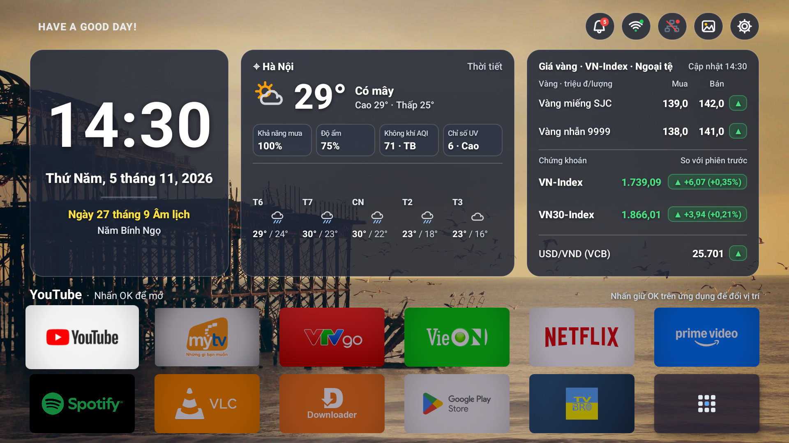

# AnhPT VN Launcher (CleanYourTV - VN Dashboard)

Giao diện Android TV thuần Việt siêu nhẹ, hiện đại, tối ưu riêng cho **Mecool KM2** (Amlogic S905X4) và các dòng Android TV Box tương thích.



---

## ✨ Tính năng nổi bật

1. **Thanh trạng thái tối giản (Icon-only Status Bar):**
   - Chuông thông báo hệ thống kèm huy hiệu số (Badge counter).
   - Biểu tượng mạng Wi-Fi và LAN hiển thị trạng thái kết nối trực quan.
   - Nút tuỳ chỉnh hình nền nhanh & lối tắt vào Cài đặt hệ thống TV.

2. **Cụm Widget Trung tâm (Frosted Glass Widgets):**
   - **Widget Thời gian & Lịch Âm Dương (Bên trái):** Giờ số lớn in đậm (`HH:mm`), Thứ - Ngày - Tháng - Năm dương lịch và Ngày/Tháng/Năm Âm lịch (Can Chi).
   - **Widget Thời tiết (Ở giữa):** Cập nhật thời tiết theo địa phương (Hà Nội, TP.HCM, Đà Nẵng, v.v.), nhiệt độ, độ ẩm, chỉ số UV, chất lượng không khí AQI và dự báo 5 ngày tới.
   - **Widget Thị trường (Bên phải):** Giá vàng miếng SJC, vàng nhẫn 9999, chỉ số chứng khoán VN-Index & VN30-Index, tỷ giá USD/VND (VCB) kèm huy hiệu xu hướng tăng/giảm (`▲` / `▼`).

3. **Lưới ứng dụng chuẩn Google TV (2x6 App Grid):**
   - Khung thẻ ứng dụng tỉ lệ chuẩn `16:9` (`128dp x 72dp`), bo góc `6dp` tinh tế như Google TV gốc.
   - Hỗ trợ banner tràn viền (Full-bleed), tự động cân chỉnh logo và làm dịu nền đối với các ô chưa trỏ tới.
   - Cho phép gán / thay đổi vị trí ứng dụng yêu thích bằng cách nhấn giữ phím `OK` trên điều khiển.
   - Nút `+` (Thêm ứng dụng) và nút xem toàn bộ ứng dụng (`Tất cả ứng dụng`).

4. **Trình quản lý Hình nền tự động & Tuỳ biến độ mờ:**
   - Hỗ trợ tự động đổi hình nền từ kho ảnh chất lượng cao miễn phí (Bing Daily, Unsplash, Picsum) hoặc chọn ảnh từ máy/USB.
   - Điều chỉnh độ mờ đục nền Widget (0% - 85%) và độ sáng phông nền trực tiếp từ remote.

---

## 🛠 Hướng dẫn Biên dịch & Cài đặt

### Yêu cầu
- Windows 10/11
- Android SDK Build-Tools (`aapt2`, `d8`, `apksigner`)
- Java JDK (`javac`)
- `adb` (Android Debug Bridge)

### Các bước thực hiện

1. **Biên dịch APK:**
   ```powershell
   powershell.exe -ExecutionPolicy Bypass -File .\build_vn_launcher.ps1
   ```
   Tệp APK đầu ra sẽ được tạo tại `CleanYourTV-VN.apk`.

2. **Cài đặt lên Android TV qua mạng LAN (ADB):**
   ```cmd
   .\install_vn_launcher.bat <IP_CUA_TV>
   ```
   *Ví dụ:* `.\install_vn_launcher.bat 192.168.8.31` hoặc `.\install_vn_launcher.bat 192.168.8.15`.

3. **Tối ưu & Tắt các ứng dụng chạy ngầm không cần thiết (Debloat):**
   ```cmd
   .\debloat_km2.bat
   ```

---

## 📂 Cấu trúc Thư mục

```
├── vn-launcher/
│   ├── AndroidManifest.xml
│   ├── res/
│   └── src/com/gathin/tvhome/
│       ├── MainActivity.java           # Điều khiển giao diện chính, widget, app grid
│       ├── LunarCalendar.java          # Thuật toán tính Lịch Âm Việt Nam & Can Chi
│       ├── WeatherIconView.java        # Vẽ icon thời tiết vector động
│       ├── StatusIconView.java         # Vẽ icon trạng thái Wi-Fi, LAN, Settings, Apps
│       └── TvNotificationListener.java # Lắng nghe và đếm thông báo TV
├── build_vn_launcher.ps1               # Script tự động build APK không cần Android Studio
├── install_vn_launcher.bat             # Cài đặt APK & gán launcher mặc định qua ADB
├── debloat_km2.bat                     # Tắt các gói telemetry/dịch vụ thừa của Mecool KM2
├── restore_km2.bat                     # Khôi phục các dịch vụ đã tắt
└── README.md
```
